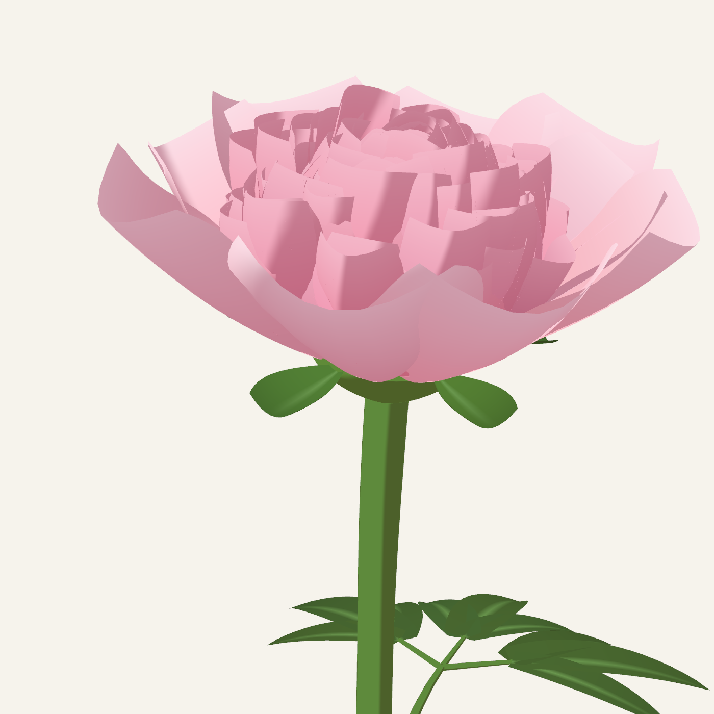
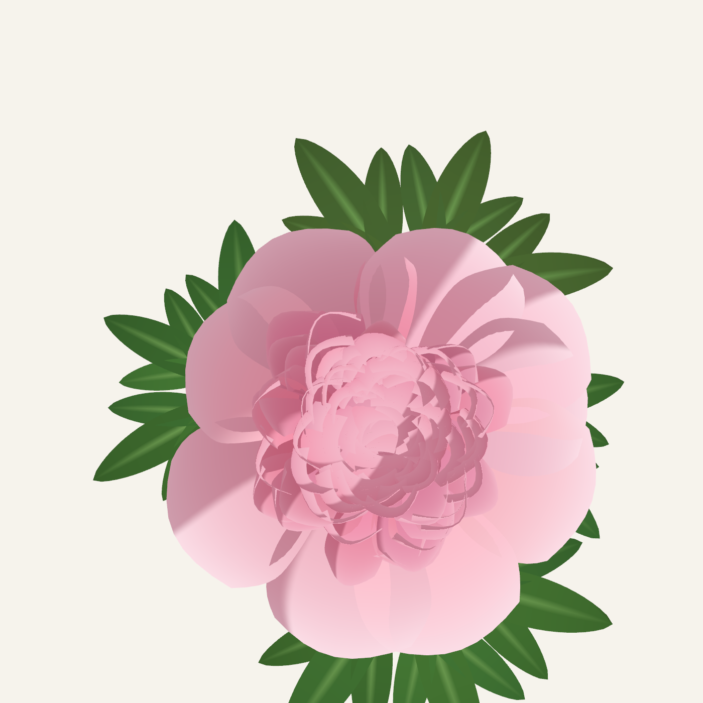
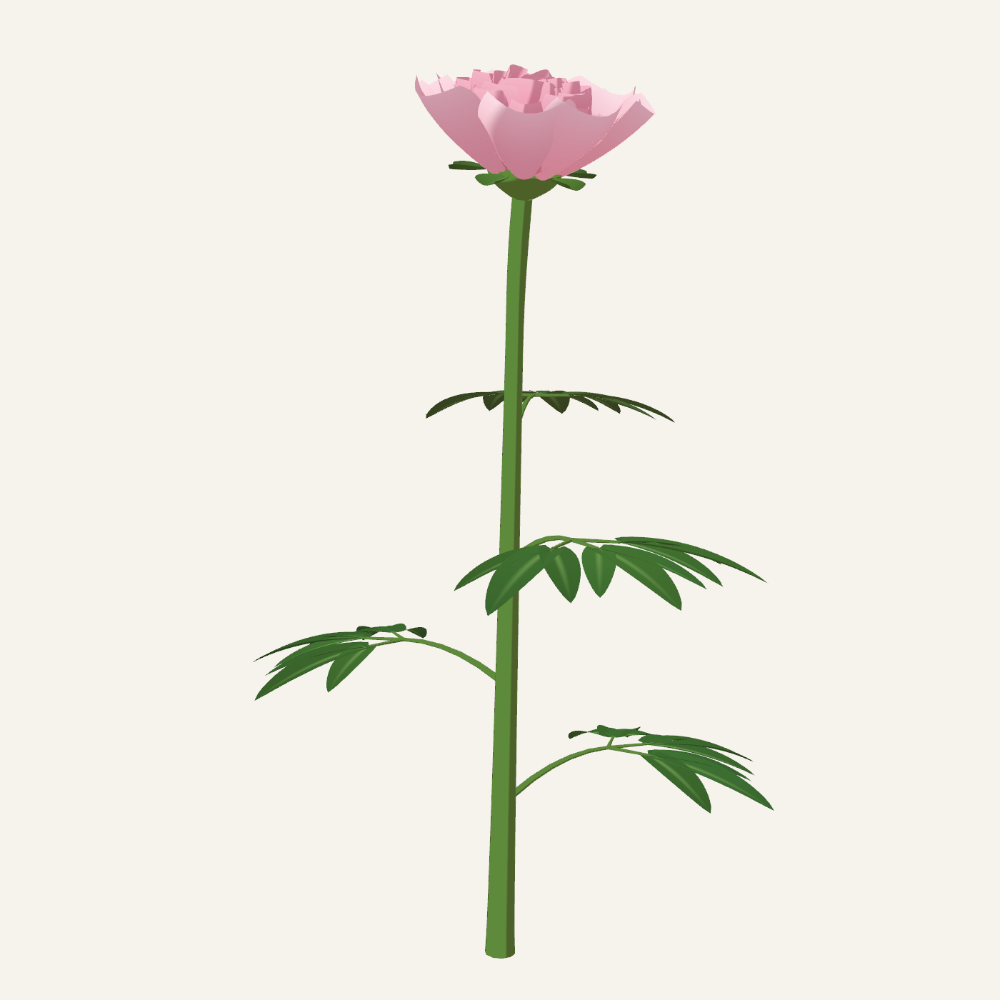
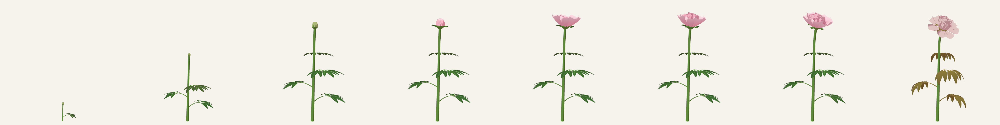
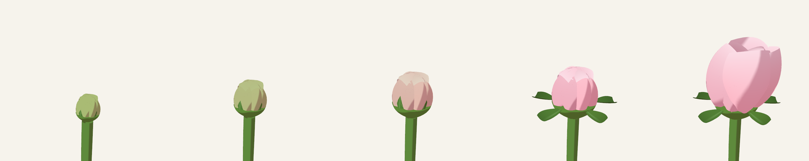

# peony-gen

A peony grown in Unity out of arithmetic. No models, no textures. Stem, leaves, sepals and around a hundred and fifty petals are meshes built in C# from a handful of numbers, and the whole life of the flower runs off one parameter from 0 to 1.



## A pompom on a disc

The middle of a double peony is a crowd: 140 small petals packed into a dome. Petal `n` sits at angle `n · 137.5°` and radius `√n`, Vogel's disc, the same rule that packs sunflower seeds. So nobody places them, and they still fill the circle without gaps or clumps.



Petals near the centre stand almost upright and curl inward. Toward the rim they lean out further and further. Nine wide guard petals wrap around the whole thing, five sepals sit under them every 144°, and leaves go up the stem on the golden angle.

```
inner petals   140, Vogel disc, tilt 4° at the centre to 72° at the rim
guard petals   9, every 137.5°
sepals         5, every 144°
leaves         4 up the stem, every 137.5°
leaf           three segments of three leaflets
```



## One parameter, one life

```
0.00 - 0.30   stem grows, leaves unfold
0.12 - 0.50   bud swells into a ball
0.30 - 0.46   the ball goes from green to pink
0.38 - 0.48   sepals open up
0.44 - 0.62   guard petals fall open
0.48 - 0.76   the pompom fluffs up
0.78 - 0.97   petals fade, the head bows
0.84 - 1.00   leaves dry
```



Every stage is a smoothstep between two thresholds, so any value of `life` gives a frame nobody drew by hand.

## The bud

A peony bud is a hard round ball. The guard petals do it on their own: shut, each one curls 150° over the top, and together they close into a sphere. Opening just unwinds that curl.



## Not too perfect

A perfect Vogel disc looks like a staircase, every petal parallel to its neighbour. So each inner petal hashes its index into its own tilt, curl and twist. Same for shade. Hashes, not random numbers, so the same seed always grows the same peony and any frame renders on its own.

## The look

Flat fills, one light, a hard shadow band. The shadow is warm on purpose (a cold one turns pink lilac). The shader and mesh buffer are shared with [rose-gen](https://github.com/tantaneity/rose-gen), [sunflower-gen](https://github.com/tantaneity/sunflower-gen) and the rest of the family.

Built with Unity 6000.3.5f2 and URP.

## Licence

MIT.
